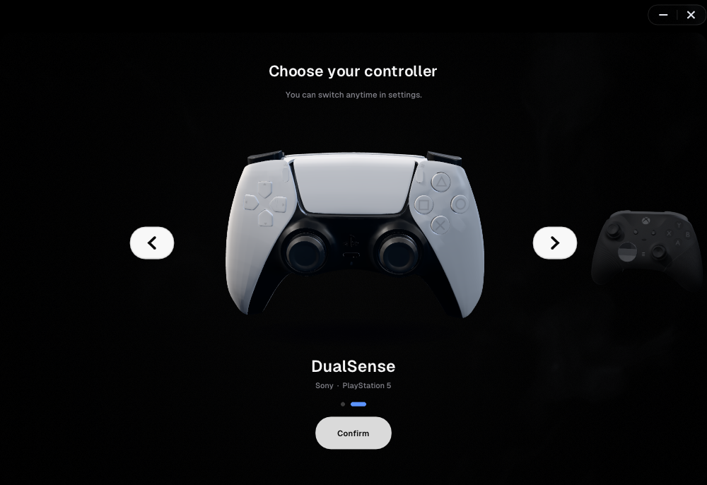

<div align="center">

# Strafe

**Play with keyboard and mouse. Show up as a real controller.**



</div>

---

Strafe turns your keyboard and mouse into a virtual gamepad. Pick a DualSense or an Xbox Elite, bind your keys, and the game sees a real controller plugged in.

I wanted something like reWASD that didn't cost money and didn't feel clunky, so I built this. It's free and open source, and it's still early.

## What it does

- **Real controllers.** Shows up in Windows as a DualSense or an Xbox Elite controller, not a generic pad.
- **Bind anything.** Any key, any mouse button, scroll up/down, even the back paddles.
- **Mouse to stick that feels right.** Mouse speed drives the stick at 500 Hz, and you can shape the response on a curve.
- **Stays out of your way.** Whenever a cursor is on screen, like in menus or on the desktop, your mouse works like normal.
- **One key on, one key off.** Bind a power key and toggle it from anywhere.

## Getting started

1. Grab `Strafe.exe` from the [releases](../../releases) page.
2. Run it. It asks for admin because it creates a virtual device.
3. Hit **Install driver** the first time.
4. Pick your controller and set up your binds.
5. Click the PS / Xbox button on the controller and bind a **power key**.
6. Jump in a game and press your power key.

Windows 10 or 11 (64-bit) only.

## Building it yourself

You'll need:

- Visual Studio 2026 with the **Desktop development with C++** workload
- Windows SDK and **Windows Driver Kit** 10.0.26100
- CMake 3.20 or newer

```powershell
cmake -S . -B build -G "Visual Studio 18 2026" -A x64
cmake --build build --config Release
```

The app ends up in `bin\Release\Strafe.exe`. The driver package is built along with it; it's only signed if you've made a local certificate with `src\driver\make_certificate.ps1`.

## Layout

```
src/app       the app: window, rendering, UI
src/engine    the remapping engine
src/driver    driver build and packaging scripts
ext/          third-party code (ImGui, cgltf, DuoController)
assets/       models, fonts, icons
```

## A quick note

Some games have rules about input devices and remapping, especially in ranked or competitive modes. Check them before you use this online.

## Credits

The virtual controller driver is [DuoController](https://github.com/DuoStream/DuoController) by Black-Seraph. The 3D models, fonts and button icons come from some great people too, all listed in [assets/CREDITS.md](assets/CREDITS.md).

## License

MIT. See [LICENSE](LICENSE). Third-party parts keep their own licenses.
